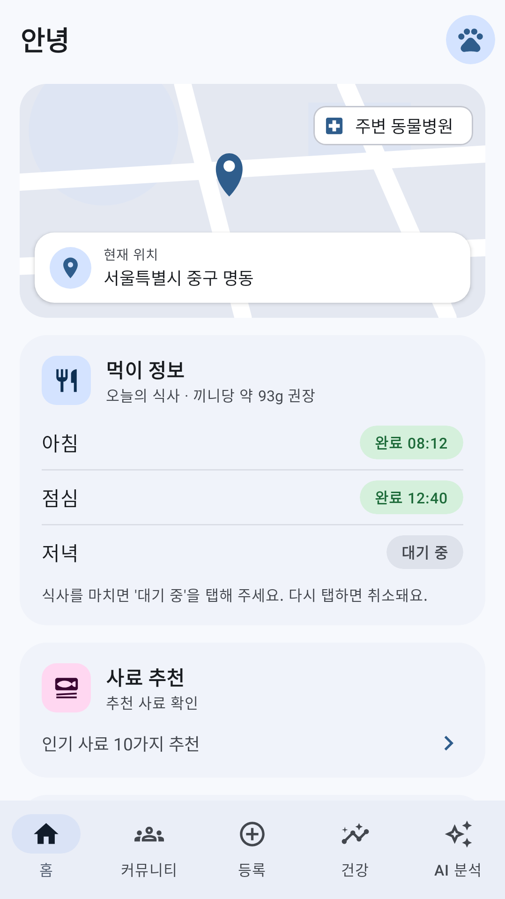
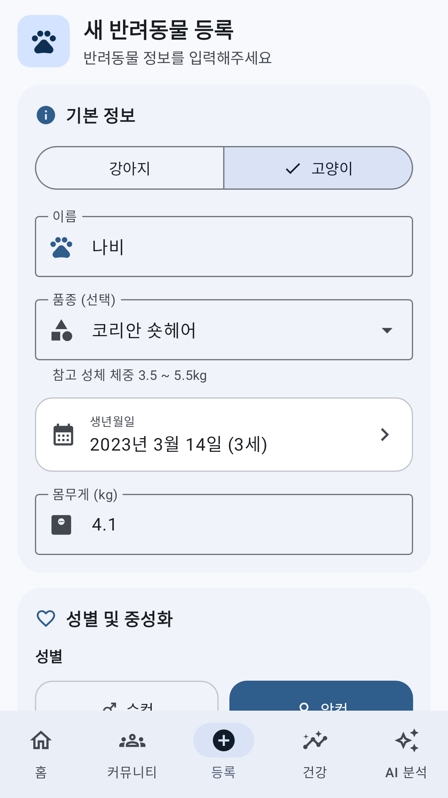

# 견심이 🐾

**케어는 간편하게, 반려동물은 건강하게.**
PETFATHER 팀의 반려동물 건강 기록 안드로이드 앱입니다. 먹이·건강 기록, 그래프, 기록을 바탕으로 한 건강 분석, 사료 추천, 커뮤니티를 앱 하나에서 제공합니다.

| 홈 | 건강 | AI 분석 | 등록 | 커뮤니티 |
|---|---|---|---|---|
|  |  |  |  |  |

더 많은 화면(다크 모드, 주의 신호, 사료 목록, 건강 입력)은 [`docs/screenshots`](docs/screenshots)에 있습니다.

## 사용 방법

1. **등록** 탭(+)에서 강아지나 고양이를 등록합니다.
2. 매일 **홈**에서 아침·점심·저녁 식사를 탭해 기록하고, 저녁에 **건강 정보 +** 로 체중·체온·심박수·건강 태그를 입력합니다. 먹이 정보를 먼저 입력해야 건강 정보를 저장할 수 있어요.
3. **건강** 탭에서 기간별 그래프를, **AI 분석** 탭에서 권장 체중·급여량·주의 신호를 봅니다.

## 기능

| 화면 | 내용 |
|---|---|
| 홈 | 현재 위치 지도와 '주변 동물병원' 바로가기, 오늘의 식사(아침·점심·저녁), 사료 추천, 오늘의 건강 정보 |
| 커뮤니티 | 글쓰기(사진 첨부), 좋아요, 댓글, 내 글 삭제 |
| 등록 | 강아지·고양이, 이름, 품종(목록 선택 또는 직접 입력), 생년월일, 몸무게, 성별, 중성화, 알레르기, 기저질환. 한 계정에 여러 마리를 등록할 수 있어요 |
| 건강 | 7일, 30일, 전체 기간의 체중·체온·심박수 그래프와 정상 참고 범위, 건강 태그 횟수 |
| AI 분석 | 체중 상태, 품종별 권장 체중 범위, 하루 권장 열량과 급여량, 주의 신호(고열, 급격한 체중 변화, 반복되는 증상), 건강 관리 팁 |
| 상단 발바닥 버튼 | 반려동물 전환·수정·삭제, 커뮤니티 닉네임, 저녁 8시 기록 알림 |

### 건강 분석 기준

`domain/HealthAnalyzer.kt`의 **규칙 기반** 분석입니다. 머신러닝 모델을 쓰지 않습니다. 화면에는 "진단이 아니며 이상이 있으면 동물병원에 문의하세요"라는 안내가 항상 함께 표시됩니다.

- 권장 체중: 품종별 참고 범위(`BreedCatalog.kt`, 32종). 목록에 없는 품종은 등록 체중 ±10%를 씁니다
- 정상 참고 범위: 체온은 강아지 37.5~39.2°C, 고양이 38.0~39.2°C. 심박수는 강아지 60~160bpm, 고양이 140~220bpm
- 급여량: RER(70 × 체중^0.75)에 생애 단계·중성화·체중 상태 계수를 곱하고, 건사료 3.7kcal/g으로 환산합니다
- 주의 신호: 최근 3일 안의 체온·심박 이상, 30일 안의 10% 이상 체중 변화, 3일 중 2일 이상 반복된 증상 태그

> 수치와 품종 범위는 일반적으로 알려진 참고값을 단순화한 것입니다. 출시 전에 수의사 자문을 받아 검토하길 권합니다.

## 기술 스택

- Kotlin, Jetpack Compose (Material 3), Navigation Compose
- Room (기기 안 데이터베이스), DataStore (설정), WorkManager (저녁 알림)
- Google Play services Location, Maps Compose (API 키가 있을 때만 지도 표시), Coil (사진)
- 테스트: JUnit, Robolectric, Roborazzi (화면 스크린샷)
- minSdk 26 (Android 8.0), targetSdk 36, compileSdk 37, AGP 9.5, Gradle 9.8

## 개발 환경 준비

1. 최신 **Android Studio**를 설치하고 이 저장소를 엽니다. Gradle 동기화가 끝나면 ▶ 실행하면 됩니다.
2. 명령줄로 빌드하려면 다음 명령을 씁니다.
   ```bash
   ./gradlew assembleDebug          # 디버그 APK: app/build/outputs/apk/debug/app-debug.apk
   ./gradlew testDebugUnitTest      # 단위·화면·흐름 테스트
   ```
3. **(선택) Google 지도**: [Google Cloud 콘솔](https://console.cloud.google.com/google/maps-apis)에서 *Maps SDK for Android* 키를 발급해 `local.properties`에 넣습니다.
   ```properties
   MAPS_API_KEY=발급받은_키
   ```
   키가 없으면 지도 대신 그림이 보이고, 현재 주소 표시와 '주변 동물병원' 버튼은 그대로 동작합니다. 키에는 패키지 이름과 SHA-1 인증서 제한을 꼭 걸어 두세요.

### 화면 스크린샷 다시 만들기

```bash
./gradlew :app:testDebugUnitTest --tests '*ScreenshotTest*' -Proborazzi.record=true
# 결과 PNG: app/build/outputs/roborazzi
```

## 구글 플레이 비공개 테스트 올리기

### 1. 업로드 키 만들기 (한 번만)

```bash
keytool -genkeypair -v -keystore upload-key.jks -keyalg RSA -keysize 2048 \
  -validity 10000 -alias upload
```

저장소 최상위에 `keystore.properties`를 만듭니다. 이 파일과 `.jks`는 `.gitignore`에 들어 있어 커밋되지 않습니다.

```properties
storeFile=upload-key.jks
storePassword=키스토어_비밀번호
keyAlias=upload
keyPassword=키_비밀번호
```

> ⚠️ 업로드 키와 비밀번호는 팀 비밀 저장소(예: 1Password)에 따로 백업하세요. 잃어버리면 Play Console에서 키 재설정을 요청해야 합니다.

### 2. 릴리스 번들(AAB) 빌드

```bash
./gradlew bundleRelease
# 결과: app/build/outputs/bundle/release/app-release.aab
```

새 버전을 올릴 때마다 `app/build.gradle.kts`의 `versionCode`를 1씩 올리고 `versionName`도 함께 바꿔 주세요.

### 3. Play Console 설정

1. [Play Console](https://play.google.com/console)에서 개발자 계정을 만들고(등록비 25달러) **앱 만들기**를 누릅니다. 앱 이름은 *견심이*, 기본 언어는 한국어, 앱/무료로 설정합니다.
2. **앱 콘텐츠**를 채웁니다.
   - 개인정보처리방침 URL: [`PRIVACY_POLICY.md`](PRIVACY_POLICY.md)에서 `[ ]` 부분을 채운 뒤 공개 웹 주소(노션 공개 페이지, Google Sites, GitHub Pages 등)에 올려 그 주소를 입력합니다
   - 광고: 없음
   - 콘텐츠 등급 설문, 타겟층(아동 대상 앱이 아니라면 13세 미만은 선택하지 않습니다), 데이터 보안 양식 (아래 참고)
3. **스토어 등록정보**에는 [`docs/store`](docs/store)의 파일을 씁니다.
   - 앱 아이콘: `icon_512.png` (512×512)
   - 그래픽 이미지: `feature_graphic.png` (1024×500)
   - 휴대전화 스크린샷: `1_home.png` ~ `5_community.png` (9:16)
4. **테스트 → 비공개 테스트**에서 트랙을 만들고 테스터를 등록합니다. 이메일 목록이나 Google 그룹으로 등록할 수 있습니다. 그다음 `app-release.aab`를 업로드해 출시 노트를 쓰고 **검토를 위해 전송**합니다.
5. 검토가 끝나면 **테스터 참여 링크(옵트인 URL)**를 테스터에게 보냅니다. 링크에서 참여를 누른 사람만 Play 스토어에서 앱을 설치할 수 있습니다.

> 📌 2023년 11월 이후에 만든 **개인 개발자 계정**은 프로덕션 출시 신청 전에 **테스터 12명 이상이 14일 연속으로 참여**한 비공개 테스트가 필요합니다. 정책은 바뀔 수 있으니 Play Console 대시보드의 안내를 확인하세요.

### 데이터 보안 양식 작성 참고

| 항목 | 이 앱의 동작 |
|---|---|
| 서버 전송 | 없음. 반려동물 정보, 기록, 커뮤니티 글, 사진은 모두 기기 안(Room DB와 앱 저장소)에만 저장됩니다 |
| 위치 | 사용자가 허용한 경우에만 현재 주소를 표시하는 데 씁니다. 앱은 위치를 저장하거나 전송하지 않습니다. 다만 주소 변환(Geocoder)과 지도 표시는 Google Play 서비스를 거칩니다 |
| 사진 | 사용자가 고른 사진을 앱 내부 저장소에 복사합니다 (권한 없는 Photo Picker 사용) |
| 알림 | 저녁 기록 알림을 켠 경우에만 알림 권한을 요청합니다 |
| 백업 | Android 기본 백업이 켜져 있어 사용자의 Google 계정 백업에 앱 데이터가 포함될 수 있습니다 |
| 데이터 삭제 | 반려동물을 삭제하면 해당 기록이 함께 지워집니다. 앱을 삭제하면 모든 데이터가 삭제됩니다 |

양식의 최종 판단은 팀이 Play 정책을 확인한 뒤 내려 주세요. 위치는 '수집함(앱 기능, 일시적 처리, 공유 안 함)'으로 보수적으로 신고하는 방법도 있습니다.

## 베타에서 아직 안 되는 것 (다음 단계)

- **커뮤니티 서버**: 지금은 글과 댓글이 각 기기에만 저장되어 다른 테스터와 공유되지 않습니다. 앱에도 이렇게 안내하고 있습니다. Firebase(Auth + Firestore + Storage) 같은 서버를 붙이면 `CommunityRepository`만 바꾸면 됩니다. 글이 다른 사용자에게 공개되면 Play 정책상 신고·차단 기능도 함께 넣어야 합니다.
- **AI 분석 고도화**: 지금은 규칙 기반입니다. LLM을 붙이려면 API 키를 앱에 넣지 말고 반드시 서버(예: Cloud Functions)를 거쳐 호출해야 합니다.
- **사료 목록**: `domain/FeedCatalog.kt`는 국내에서 많이 찾는 브랜드를 정리한 예시입니다. 판매 데이터에 근거한 순위가 아니므로 팀에서 검토한 뒤 갱신하세요.
- **패키지 이름**: `com.petfather.gyeonsimi`입니다. Play Console에 처음 업로드하면 바꿀 수 없으니 업로드 전에 확정하세요.

## 폴더 구조

```
app/src/main/java/com/petfather/gyeonsimi/
├── data/db        Room 엔티티·DAO·DB
├── data/repo      반려동물·먹이/건강·커뮤니티·설정 저장소
├── domain         건강 분석, 품종 체중표, 사료 목록
├── notify         저녁 기록 알림 (WorkManager)
└── ui             홈·커뮤니티·등록·건강·AI 화면, 공통 컴포넌트, 테마
app/src/test/      단위 테스트, 화면 스크린샷(Roborazzi), 앱 흐름 테스트
docs/              스크린샷과 스토어 등록용 이미지
```

---
PETFATHER · 최윤성, 박현웅, 이민재
