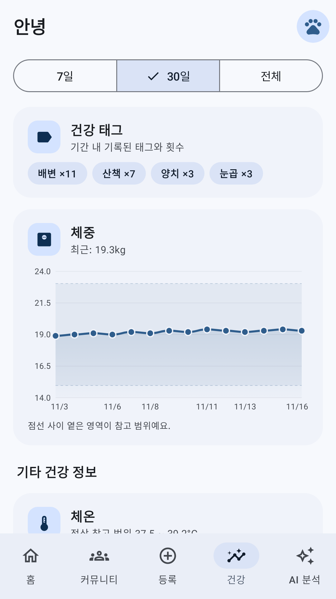
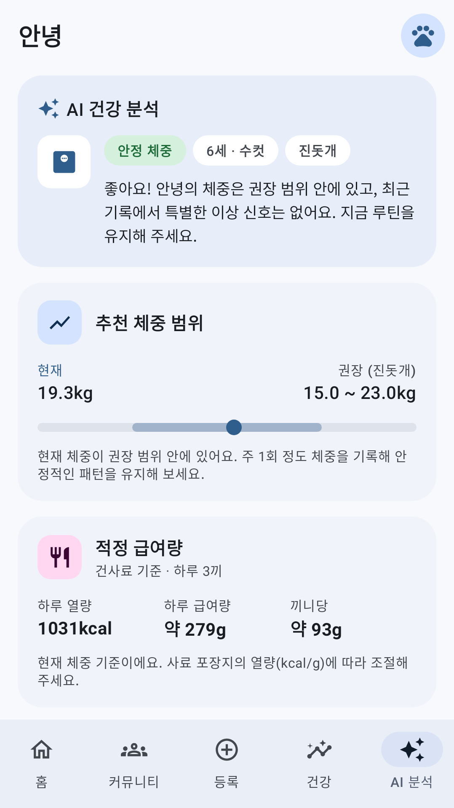
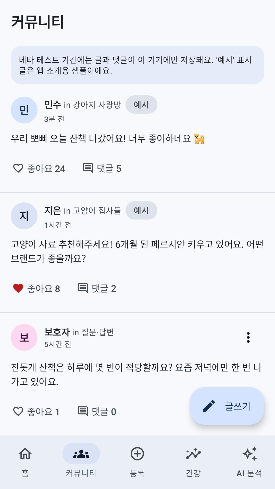

# 견심이 2.0 🐾

**케어는 간편하게, 반려동물은 건강하게.**
PETFATHER 팀의 반려동물 건강 기록 안드로이드 앱입니다. 먹이·건강 기록, 그래프, 기록을 바탕으로 한 건강 분석, 사료 추천, 커뮤니티를 앱 하나에서 제공합니다.

| 홈 | 건강 | AI 분석 | 등록 | 커뮤니티 |
|---|---|---|---|---|
|  |  |  |  |  |

더 많은 화면(첫 실행 안내, 의견 보내기, 다크 모드, 주의 신호, 사료 목록, 건강 입력)은 [`docs/screenshots`](docs/screenshots)에 있습니다.

## 사용 방법

1. **등록** 탭(+)에서 강아지나 고양이를 등록합니다.
2. 매일 **홈**에서 아침·점심·저녁 식사를 탭해 기록하고, 저녁에 **건강 정보 +** 로 체중·체온·심박수·건강 태그를 입력합니다. 먹이 정보를 먼저 입력해야 건강 정보를 저장할 수 있어요.
3. **건강** 탭에서 기간별 그래프를, **AI 분석** 탭에서 권장 체중·급여량·주의 신호를 봅니다.

## 기능

| 화면 | 내용 |
|---|---|
| 홈 | 현재 위치 지도와 '주변 동물병원' 바로가기, 오늘의 식사(아침·점심·저녁), 사료 추천, 오늘의 건강 정보, 의견 보내기 |
| 커뮤니티 | 글쓰기(사진 첨부), 좋아요, 댓글, 내 글 삭제 |
| 등록 | 강아지·고양이, 이름, 품종(목록 선택 또는 직접 입력), 생년월일, 몸무게, 성별, 중성화, 알레르기, 기저질환. 한 계정에 여러 마리를 등록할 수 있어요 |
| 건강 | 7일, 30일, 전체 기간의 체중·체온·심박수 그래프와 정상 참고 범위, 건강 태그 횟수 |
| AI 분석 | 체중 상태, 품종별 권장 체중 범위, 하루 권장 열량과 급여량, 주의 신호(고열, 급격한 체중 변화, 반복되는 증상), 건강 관리 팁 |
| 상단 발바닥 버튼 | 반려동물 전환·수정·삭제, 커뮤니티 닉네임, 저녁 8시 기록 알림, 데이터 설정(익명 사용 통계, 체중 기록 익명 공유, 보낸 체중 기록 삭제), 의견 보내기 |
| 첫 실행 안내 | 무엇이 폰에만 남고 무엇을 서버로 보내는지 알리고 선택을 받습니다. 답하기 전에는 아무것도 보내지 않아요 |

### 건강 분석 기준

`domain/HealthAnalyzer.kt`의 **규칙 기반** 분석입니다. 머신러닝 모델을 쓰지 않습니다. 화면에는 "진단이 아니며 이상이 있으면 동물병원에 문의하세요"라는 안내가 항상 함께 표시됩니다.

- 권장 체중: 품종별 참고 범위(`BreedCatalog.kt`, 32종). 목록에 없는 품종은 등록 체중 ±10%를 씁니다
- 정상 참고 범위: 체온은 강아지 37.5~39.2°C, 고양이 38.0~39.2°C. 심박수는 강아지 60~160bpm, 고양이 140~220bpm
- 급여량: RER(70 × 체중^0.75)에 생애 단계·중성화·체중 상태 계수를 곱하고, 건사료 3.7kcal/g으로 환산합니다
- 주의 신호: 최근 3일 안의 체온·심박 이상, 30일 안의 10% 이상 체중 변화, 3일 중 2일 이상 반복된 증상 태그

> 수치와 품종 범위는 일반적으로 알려진 참고값을 단순화한 것입니다. 출시 전에 수의사 자문을 받아 검토하길 권합니다.

## 서버로 보내는 데이터

반려동물 정보와 기록은 폰 안(Room DB)에 저장합니다. 서버(Supabase)로는 아래 세 가지만, 사용자가 고른 경우에만 보냅니다. 코드는 `data/remote/Telemetry.kt`에 모여 있습니다.

| 종류 | 언제 | 보내는 내용 |
|---|---|---|
| 익명 사용 통계 | 첫 실행 안내에서 켠 경우 (기본 켜짐, 설정에서 끌 수 있음) | 무작위 설치 ID, 날짜, 이벤트 종류, 앱 버전. 이벤트는 앱 열기·반려동물 등록·식사 기록·건강 기록·글 작성·의견 전송 여섯 가지이고 하루에 종류마다 한 번만 보냅니다. 무엇을 입력했는지는 보내지 않습니다 |
| 체중 기록 | '체중 기록 공유'에 동의한 경우에만 | 무작위 설치 ID, 반려동물 번호, 날짜, 체중, 종류, 품종, 태어난 달, 성별, 중성화 여부, 앱 버전 |
| 의견 | 사용자가 '보내기'를 누른 경우 | 무작위 설치 ID, 분류, 만족도(선택), 내용, 앱 버전, Android 버전 |

보내지 않는 것: 반려동물 이름, 메모, 체온·심박수·건강 태그, 알레르기·기저질환, 사진, 위치, 커뮤니티 글과 닉네임, 광고 ID나 기기 고유 번호.

### 서버 설정

서버 주소와 **공개 키**를 `local.properties`에 넣습니다. 이 파일은 커밋되지 않으니 빌드하는 컴퓨터마다 넣어야 합니다. 값은 Supabase 대시보드의 프로젝트 설정(API 항목)에서 볼 수 있습니다.

```properties
SUPABASE_URL=https://<프로젝트 ID>.supabase.co
SUPABASE_KEY=sb_publishable_로_시작하는_공개_키
```

- `sb_secret_`로 시작하는 비밀 키는 앱에 절대 넣지 마세요. 앱에는 공개 키만 넣습니다.
- 값이 없으면 디버그 빌드는 서버 기능(안내, 데이터 설정, 의견 보내기)을 숨기고 동작합니다. **릴리스 빌드는 실패합니다.** 통계가 빠진 채 출시되면 그 기간의 숫자를 되살릴 수 없기 때문입니다.
- 표와 보안 규칙은 [`supabase/migrations`](supabase/migrations)에 있습니다. 새 프로젝트를 만들 때는 번호 순서대로 SQL 편집기에서 실행합니다.
- 앱(공개 키)은 세 표에 **추가만** 할 수 있고 읽기·수정은 할 수 없습니다. 예외는 자기 설치 ID의 체중 기록을 지우는 `delete_my_weight_records` 함수 하나입니다. Supabase 보안 점검이 이 함수에 경고(WARN)를 띄우는데 의도한 설계입니다.
- 디버그 빌드가 보낸 줄은 `debug = true`로 표시되어 아래 지표에서 빠집니다.

> ⚠️ Supabase 무료 요금제 프로젝트는 요청이 약 일주일 동안 없으면 일시 중지됩니다. 테스트나 출시 전에 대시보드에서 프로젝트가 켜져 있는지 확인하고, 멈춰 있으면 복원(Restore)하세요. 멈춰 있는 동안 앱은 최대 7일 치 이벤트를 보관했다가 다시 보냅니다.

### 지표 보기

Supabase 대시보드의 SQL 편집기에서 실행합니다.

```sql
select * from reporting.summary;        -- 실사용자 수, 피드백 수, 체중 기록 수
select * from reporting.retention_4w;   -- 4주 유지율 (가입 월별, 마지막 줄이 전체)
select * from reporting.weight_latest;  -- 머신러닝용 체중 기록
select * from public.feedback where not debug order by created_at desc;
```

| 열 | 뜻 |
|---|---|
| `installs_total` | 한 번이라도 사용 이벤트를 보낸 설치 수 |
| `active_users_7d`, `active_users_28d` | 최근 7일, 28일 안에 앱을 쓴 설치 수 |
| `recording_users_total` | 식사나 건강 정보를 한 번이라도 기록한 설치 수 |
| `feedback_count`, `feedback_users`, `avg_rating` | 의견 수, 의견을 보낸 설치 수, 평균 만족도 |
| `weight_points`, `pets_with_weights` | 공유된 체중 기록 수(같은 날은 최신 값만), 반려동물 수 |
| `retained_week5_pct` | 첫 사용 후 28~34일째에 하루라도 쓴 비율. 첫 사용 후 34일이 지난 설치만 계산 |
| `still_using_pct` | 첫 사용 후 28일째 이후에 한 번이라도 쓴 비율. 첫 사용 후 28일이 지난 설치만 계산 |

숫자를 읽을 때 알아 둘 점:

- 통계를 끈 사용자는 어떤 숫자에도 잡히지 않습니다. 실제 사용자 수는 이보다 많을 수 있습니다.
- '설치' 단위입니다. 앱을 지웠다 다시 깔면 새 설치로 셉니다.
- 지원서에는 두 유지율 중 어느 정의를 썼는지 함께 적으세요. `retained_week5_pct`가 더 엄격한 기준입니다.

## 기술 스택

- Kotlin, Jetpack Compose (Material 3), Navigation Compose
- Room (기기 안 데이터베이스), DataStore (설정), WorkManager (저녁 알림)
- Supabase (Postgres + REST API). 별도 SDK 없이 `HttpURLConnection`으로 호출합니다
- Google Play services Location, Maps Compose (API 키가 있을 때만 지도 표시), Coil (사진)
- 테스트: JUnit, Robolectric, Roborazzi (화면 스크린샷)
- minSdk 26 (Android 8.0), targetSdk 36, compileSdk 37, AGP 9.5, Gradle 9.8

## 개발 환경 준비

1. 최신 **Android Studio**를 설치하고 이 저장소를 엽니다. Gradle 동기화가 끝나면 ▶ 실행하면 됩니다.
2. 명령줄로 빌드하려면 다음 명령을 씁니다.
   ```bash
   ./gradlew assembleDebug          # 디버그 APK: app/build/outputs/apk/debug/app-debug.apk
   ./gradlew testDebugUnitTest      # 단위·화면·흐름 테스트 (가짜 서버 사용, 실제 서버로 보내지 않음)
   ```
3. 위 '서버 설정'대로 `local.properties`에 Supabase 값을 넣습니다.
4. **(선택) Google 지도**: [Google Cloud 콘솔](https://console.cloud.google.com/google/maps-apis)에서 *Maps SDK for Android* 키를 발급해 `local.properties`에 넣습니다.
   ```properties
   MAPS_API_KEY=발급받은_키
   ```
   키가 없으면 지도 대신 그림이 보이고, 현재 주소 표시와 '주변 동물병원' 버튼은 그대로 동작합니다. 키에는 패키지 이름과 SHA-1 인증서 제한을 꼭 걸어 두세요.

### 실제 서버로 보내 보기

앱과 같은 코드로 실제 서버에 써 보는 테스트입니다. 보내는 줄은 `debug = true`라 지표에 잡히지 않습니다.

```bash
./gradlew :app:testDebugUnitTest --tests '*LiveBackendTest*' -Pgyeonsimi.liveBackendTest=true
```

### 화면 스크린샷 다시 만들기

```bash
./gradlew :app:testDebugUnitTest --tests '*ScreenshotTest*' -Proborazzi.record=true
# 결과 PNG: app/build/outputs/roborazzi
```

## 구글 플레이 비공개 테스트 올리기

### 1. 업로드 키 만들기 (한 번만)

```bash
keytool -genkeypair -v -keystore upload-key.jks -keyalg RSA -keysize 2048 \
  -validity 10000 -alias upload
```

저장소 최상위에 `keystore.properties`를 만듭니다. 이 파일과 `.jks`는 `.gitignore`에 들어 있어 커밋되지 않습니다.

```properties
storeFile=upload-key.jks
storePassword=키스토어_비밀번호
keyAlias=upload
keyPassword=키_비밀번호
```

> ⚠️ 업로드 키와 비밀번호는 팀 비밀 저장소(예: 1Password)에 따로 백업하세요. 잃어버리면 Play Console에서 키 재설정을 요청해야 합니다.

### 2. 릴리스 번들(AAB) 빌드

```bash
./gradlew bundleRelease
# 결과: app/build/outputs/bundle/release/app-release.aab
```

새 버전을 올릴 때마다 `app/build.gradle.kts`의 `versionCode`를 1씩 올리고 `versionName`도 함께 바꿔 주세요.

### 3. Play Console 설정

1. [Play Console](https://play.google.com/console)에서 개발자 계정을 만들고(등록비 25달러) **앱 만들기**를 누릅니다. 앱 이름은 *견심이 2.0*, 기본 언어는 한국어, 앱/무료로 설정합니다.
2. **앱 콘텐츠**를 채웁니다.
   - 개인정보처리방침 URL: [`PRIVACY_POLICY.md`](PRIVACY_POLICY.md)에서 `[ ]` 부분을 채운 뒤 공개 웹 주소(노션 공개 페이지, Google Sites, GitHub Pages 등)에 올려 그 주소를 입력합니다
   - 광고: 없음
   - 콘텐츠 등급 설문, 타겟층(아동 대상 앱이 아니라면 13세 미만은 선택하지 않습니다), 데이터 보안 양식 (아래 참고)
3. **스토어 등록정보**에는 [`docs/store`](docs/store)의 파일을 씁니다.
   - 앱 아이콘: `icon_512.png` (512×512)
   - 그래픽 이미지: `feature_graphic.png` (1024×500)
   - 휴대전화 스크린샷: `1_home.png` ~ `5_community.png` (9:16)
4. **테스트 → 비공개 테스트**에서 트랙을 만들고 테스터를 등록합니다. 이메일 목록이나 Google 그룹으로 등록할 수 있습니다. 그다음 `app-release.aab`를 업로드해 출시 노트를 쓰고 **검토를 위해 전송**합니다.
5. 검토가 끝나면 **테스터 참여 링크(옵트인 URL)**를 테스터에게 보냅니다. 링크에서 참여를 누른 사람만 Play 스토어에서 앱을 설치할 수 있습니다.

> 📌 2023년 11월 이후에 만든 **개인 개발자 계정**은 프로덕션 출시 신청 전에 **테스터 12명 이상이 14일 연속으로 참여**한 비공개 테스트가 필요합니다. 정책은 바뀔 수 있으니 Play Console 대시보드의 안내를 확인하세요.

### 데이터 보안 양식 작성 참고

이 앱은 데이터를 **수집합니다**(서버로 전송). 제3자와 공유하지는 않습니다.

| 양식의 데이터 유형 | 이 앱에서 해당하는 것 | 수집 목적 | 선택 사항인가 |
|---|---|---|---|
| 앱 활동 → 앱 상호작용 | 익명 사용 이벤트 (앱 열기, 기능 사용 여부) | 분석 | 예 (설정에서 끌 수 있음) |
| 기기 또는 기타 ID | 앱이 만든 무작위 설치 ID | 분석 | 예 |
| 앱 활동 → 기타 사용자 생성 콘텐츠 | 의견 내용, 공유에 동의한 체중 기록 | 분석, 앱 기능 | 예 |

| 그 밖의 항목 | 이 앱의 동작 |
|---|---|
| 전송 중 암호화 | 예 (HTTPS) |
| 데이터 삭제 요청 | 체중 기록은 앱 설정의 '보낸 체중 기록 삭제'로 지울 수 있습니다 |
| 위치 | 사용자가 허용한 경우에만 현재 주소를 표시하는 데 씁니다. 앱은 위치를 저장하거나 전송하지 않습니다. 다만 주소 변환(Geocoder)과 지도 표시는 Google Play 서비스를 거칩니다 |
| 사진 | 사용자가 고른 사진을 앱 내부 저장소에 복사합니다 (권한 없는 Photo Picker 사용). 서버로 보내지 않습니다 |
| 알림 | 저녁 기록 알림을 켠 경우에만 알림 권한을 요청합니다 |
| 백업 | Android 기본 백업이 켜져 있어 사용자의 Google 계정 백업에 앱 데이터가 포함될 수 있습니다 |

양식의 최종 판단은 팀이 Play 정책을 확인한 뒤 내려 주세요. 반려동물 체중을 어느 유형으로 신고할지는 정책 문구를 직접 확인하길 권합니다. 위치는 '수집함(앱 기능, 일시적 처리, 공유 안 함)'으로 보수적으로 신고하는 방법도 있습니다.

## 아직 안 되는 것 (다음 단계)

- **커뮤니티 서버**: 지금은 글과 댓글이 각 기기에만 저장되어 다른 사용자와 공유되지 않습니다. 앱에도 이렇게 안내하고 있습니다. 같은 Supabase 프로젝트에 표를 추가하고 `CommunityRepository`만 바꾸면 됩니다. 글이 다른 사용자에게 공개되면 Play 정책상 신고·차단 기능도 함께 넣어야 합니다.
- **머신러닝**: 지금 AI 분석은 규칙 기반입니다. 공유된 체중 기록(`reporting.weight_latest`)이 쌓이면 예측 모델을 만들 수 있습니다. 무엇을 예측하고 정확도를 어떻게 잴지 먼저 정하세요. LLM을 붙일 때는 API 키를 앱에 넣지 말고 반드시 서버를 거쳐 호출해야 합니다.
- **사료 목록**: `domain/FeedCatalog.kt`는 국내에서 많이 찾는 브랜드를 정리한 예시입니다. 판매 데이터에 근거한 순위가 아니므로 팀에서 검토한 뒤 갱신하세요.
- **패키지 이름**: `com.petfather.gyeonsimi2`입니다. Play Console에 처음 업로드하면 바꿀 수 없습니다.

## 폴더 구조

```
app/src/main/java/com/petfather/gyeonsimi2/
├── data/db        Room 엔티티·DAO·DB
├── data/repo      반려동물·먹이/건강·커뮤니티·설정 저장소
├── data/remote    서버 전송 (Supabase API, 익명 통계·피드백·체중 공유)
├── domain         건강 분석, 품종 체중표, 사료 목록
├── notify         저녁 기록 알림 (WorkManager)
└── ui             홈·커뮤니티·등록·건강·AI·의견 화면, 첫 실행 안내, 공통 컴포넌트, 테마
app/src/test/      단위 테스트, 화면 스크린샷(Roborazzi), 앱 흐름 테스트
supabase/          서버 표·보안 규칙·지표 뷰 (SQL)
docs/              스크린샷과 스토어 등록용 이미지
```

---
PETFATHER · 최윤성, 박현웅, 이민재
